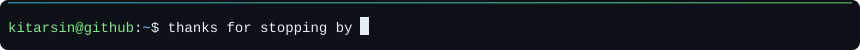

<div align="center">



<br/>

[](https://kitarsin.github.io)
[](https://github.com/kitarsin?tab=repositories)
[](https://github.com/kitarsin/mabatID)

<br/>


</div>

```text
Kristian Lawrence Villaraza (Ian) · software developer

I build practical software: web apps, APIs and browser tools, mostly in
TypeScript and C#/.NET. Lately that means MabatID, a web app a friend and I
built to help young Filipinos get their government IDs.
```

<div align="center">

<br/>


<br/><br/>

<a href="https://github.com/kitarsin/mabatID"></a>

<a href="https://github.com/kitarsin/lingualoom"></a>
<a href="https://github.com/kitarsin/ODIN"></a>

<a href="https://github.com/kitarsin/odinroot"></a>

<br/>


</div>

```text
languages   TypeScript · C# · JavaScript
runtime     .NET · ASP.NET Core · Node.js
frontend    Next.js · React · Tailwind CSS · Browser Extensions
data        Supabase (Postgres)
tools       Git · GitHub · VS Code
```

<div align="center">


<br/><br/>


</div>

```text
[ok] building    lingualoom
[ok] shipped     mabatID
[ok] polishing   ODIN, odinroot
[..] waiting for next idea_
```

<div align="center">

</div>
